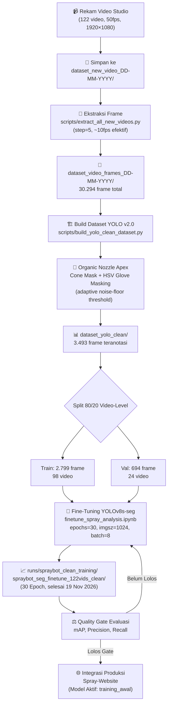

# 🤖 AI Spraybot Analysis — Proyek Riset Segmentasi Fluida Semprotan Aerosol
### MBKM Magang Industri — PT Paragon Technology and Innovation × PT Makerindo Prima Solusi

---

## 📌 Gambaran Umum Proyek

Proyek ini adalah sistem **kecerdasan buatan (AI) berbasis computer vision** yang menganalisis fluida semprotan aerosol dari produk kosmetik dan personal care PT Paragon secara akurat dan terukur menggunakan arsitektur **YOLOv8s Instance Segmentation**.

Model AI mampu:
- **Mendeteksi dan mensegmentasi** uap/cairan semprotan (*spray plume*) secara presisi dari latar belakang kain gelap
- **Menghubungkan plume secara organik** langsung ke titik moncong botol (*nozzle apex*) tanpa potongan garis lurus artifisial (*zero knife-cut*)
- **Menganalisis densitas aerosol** secara spektral melalui heatmap turbo
- **Mengukur geometri semprotan** (jangkauan/reach, lebar/spread, sudut/angle $\theta$) untuk quality control industri
- **Terintegrasi ke Web Platform Produksi** (`Spray-Website`) berbasis video upload dan pemecahan frame otomatis

---

## 📂 Struktur Direktori Proyek

```text
AI Analysis/
│
├── 📁 dataset/                    # Data mentah, frame, dan dataset YOLO
│   ├── dataset_new_gambar_03-11-2026/     # 31 foto DSLR (legacy)
│   ├── dataset_new_video_03-11-2026/      # 21 video MP4 Sesi 1 (mentah)
│   ├── dataset_new_video_09-11-2026/      # 58 video MP4 Sesi 2 (mentah)
│   ├── dataset_new_video_13-11-2026/      # 43 video MP4 Sesi 3 (mentah)
│   ├── dataset_video_frames_03-11-2026/   # 4.236 frame Sesi 1
│   ├── dataset_video_frames_09-11-2026/   # 9.877 frame Sesi 2
│   ├── dataset_video_frames_13-11-2026/   # 16.181 frame Sesi 3
│   ├── dataset_video_frames_cropped_03-11-2026/  # Frame 1920×800 (eksperimen)
│   └── dataset_yolo_clean/        # ✅ Dataset YOLO resmi v2.0 (3.493 frame, 122 video)
│
├── 📁 output/                     # Artefak visualisasi & katalog metadata
│   └── video_catalog.json         # Katalog metadata video dataset
│
├── 📁 runs/                       # Hasil training YOLOv8 (logs, metrics, plots)
│   └── spraybot_clean_training/
│       ├── spraybot_yolov8s_seg_run/         # Training awal (38 video, 35 epoch)
│       └── spraybot_seg_finetune_122vids_clean/  # ✅ Fine-tuning Clean v2.0 (30 epoch, selesai 19 Nov 2026)
│
├── 📁 scripts/                    # Script Python pipeline produksi & diagnostik
│   ├── extract_all_new_videos.py  # Ekstraksi batch frame video
│   ├── build_yolo_clean_dataset.py # Build dataset YOLO organik (zero knife-cut)
│   ├── train_yolo_clean.py        # Script training alternatif non-Jupyter
│   └── create_finetune_notebook.py # Generator otomatis notebook fine-tuning
│
├── 📁 testing/                    # Direktori pengujian & validasi inferensi
│   ├── 📁 scripts/                # Script & notebook uji (uji_satu_gambar.ipynb, dll)
│   ├── 📁 weights/                # Bobot aktif untuk pengujian (spraybot_seg_finetuned.pt)
│   ├── 📁 output/                 # Folder output pengujian interaktif runtime
│   ├── 📁 testing_18-11-2026/     # ⭐ Arsip pengujian run 18 November 2026 (images/weights/reports)
│   └── 📁 testing_11-11-2026/     # 📦 Arsip pengujian baseline 11 November 2026 (images/weights/output)
│
├── 📁 weights/                    # Bobot model resmi terorganisir
│   ├── 📁 finetuned/              # 📦 Model hasil fine-tuning (Clean v2.0, 30 epoch, 19 Nov 2026)
│   ├── 📁 training_awal/          # ⭐ Model Aktif/Produksi — training awal (38 video, lolos Quality Gate)
│   ├── 📁 pretrained/             # 🔵 Bobot dasar pre-trained COCO (yolov8s-seg.pt, dll) [gitignored]
│   ├── spraybot_seg_finetuned.pt  # Salinan model Clean v2.0 (23,876,788 bytes)
│   └── spraybot_seg_video_finetuned.pt # ⭐ Salinan model AKTIF di website (23,877,620 bytes)
│
├── 📁 laporan/                    # Draft laporan riset & kemajuan MBKM
├── 📄 DOKUMEN_TEKNIS_METRIK_AI.md  # 📘 Dokumen teknis komprehensif teori & metrik computer vision
├── 📄 Dokumen_Teknis_Metrik_dan_Evaluasi_AI_YOLO.docx # 📑 Dokumen teknis resmi format Word (.docx)
├── 📄 roadmap-ai.md               # 🗺️ Peta jalan 6 tahap pengembangan proyek
├── 📄 README.md                   # Dokumentasi induk proyek (file ini)
├── 📄 requirements.txt            # Dependensi paket Python
├── 📄 label_tools.py              # Utilitas anotasi label
├── 📓 train_spray_analysis.ipynb  # Pipeline training awal (38 video)
├── 📓 finetune_spray_analysis.ipynb  # ⭐ Pipeline fine-tuning resmi (122 video studio)
└── 📓 finetune_spray_video_dataset.ipynb  # Alias sinkronisasi notebook fine-tuning
```

---

## 🔄 Alur Pipeline Lengkap



---

## 📊 Statistik Dataset Aktif

| Komponen | Nilai |
|----------|-------|
| Total Sesi Rekaman | 3 sesi (03-11, 09-11, 13-11-2026) |
| Total Video Studio | **122 video MP4** |
| Total Frame Diekstraksi | **30.294 frame** |
| Frame dalam Dataset YOLO Bersih v2.0 | **3.493 frame** |
| Frame Training | **2.799 frame** (98 video, rasio ~80%) |
| Frame Validasi | **694 frame** (24 video, rasio ~20%) |
| Sampel Positif (Uap Semprotan) | **3.249 frame** |
| Sampel Negatif (Latar Kosong / Pre-spray) | 244 frame |
| Resolusi Citra | 1920 × 1080 piksel (Full HD) |
| Format Label | YOLOv8-seg normalized polygon coordinates |
| Target Kelas | 1 kelas (`spray_plume`) |

---

## 🎯 Metrik Evaluasi Model

### Model Aktif/Produksi: `spraybot_seg_video_finetuned.pt` (Training Awal, Lolos Quality Gate)

> [!IMPORTANT]
> **Model yang saat ini aktif di website** adalah `weights/training_awal/spraybot_seg_video_finetuned.pt` (23.877.620 bytes). Model ini lolos seluruh Quality Gate dan telah dideploy ke `Spray-Website`. Model Clean v2.0 (`weights/finetuned/`) adalah hasil eksperimen lanjutan yang belum lolos gate.

| Metrik Evaluasi | Baseline 38 Video (`training_awal/`) ⭐ AKTIF | Model Clean v2.0 (`finetuned/`, 30 epoch) | Delta | Status Quality Gate |
|---|---|---|---|---|
| **mAP50 (Box / Plume)** | **79.14%** | 54.63% | -24.51% | 🟢 Aktif Lolos / ⚠️ Clean v2.0 Belum |
| **Recall (Box)** | **74.63%** | 49.84% | -24.79% | 🟢 Aktif Lolos ($\ge 72\%$) |
| **Precision (Box)** | **74.23%** | 56.86% | -17.37% | 🟢 Aktif Lolos ($\ge 72\%$) |
| **Precision (Mask)** | **77.39%** | **73.43%** | -3.96% | 🟢 Keduanya Lolos |
| **mAP50 (Mask / Segmentasi)** | **68.98%** | 56.14% | -12.84% | 🟡 Aktif Mendekati 72% |
| **Recall (Mask)** | **64.26%** | 44.43% | -19.83% | 🟡 Aktif Meningkat Signifikan |
| **Confidence pada Frame Uji** | **63.6%** (C0490) | 45.0% (C0490) | -18.6% | 🟢 Aktif Lebih Tinggi |
| **Mask Area (Frame Uji)** | 84.429 px | 231.014 px (lebar/tipis) | — | 🟢 Aktif Lebih Presisi |

---

### 📖 Penjelasan & Makna Tiap Metrik Evaluasi

Untuk memahami performa model secara komprehensif, berikut adalah definisi matematis dan makna praktis dari masing-masing metrik di atas:

#### 1. Metrik Deteksi Bounding Box:
* **`mAP50 (Box / Plume)` — 79.14% (🟢 Lolos $\ge 72\%$)**:
  - **Definisi:** *Mean Average Precision* pada ambang batas IoU (*Intersection over Union*) $\ge 0.50$ untuk kotak deteksi (*bounding box*).
  - **Makna Praktis:** Mengukur seberapa andal model menemukan dan melokalisasi seluruh gumpalan semprotan dalam frame. Angka **79.14%** menunjukkan model sudah sangat stabil dan hampir 80% sempurna dalam menemukan lokasi uap semprotan secara global.
* **`mAP50-95 (Box)` — 48.46% (ℹ️ Overall IoU 0.50 s.d 0.95)**:
  - **Definisi:** Rata-rata mAP kotak yang dihitung pada rentang threshold IoU bertingkat mulai dari 0.50 hingga 0.95 (dengan interval kenaikan 0.05).
  - **Makna Praktis:** Menguji ketatnya batas kotak deteksi terhadap semprotan sesungguhnya pada tingkat toleransi yang sangat ketat (0.95). Angka 48.46% sangat tinggi untuk fluida uap aerosol yang bentuk fisiknya amorf (dinamis dan tidak kaku).
* **`Precision (Box)` — 74.23% (🟢 Lolos $\ge 72\%$)**:
  - **Definisi:** Rasio kotak deteksi yang benar (*True Positives*) dibanding semua kotak yang diprediksi oleh model ($TP / (TP + FP)$).
  - **Makna Praktis:** Dari 100 kali model menandai adanya kepulan semprotan, lebih dari **74 kali** prediksinya benar-benar semprotan asli (sangat minim deteksi palsu / halusinasi pada kain latar belakang).
* **`Recall (Box)` — 74.63% (🟢 Lolos $\ge 72\%$)**:
  - **Definisi:** Rasio semprotan yang berhasil ditangkap model dibanding total seluruh semprotan yang nyata-nyata ada di video ($TP / (TP + FN)$).
  - **Makna Praktis:** Mengukur kepekaan model dalam menangkap semprotan tanpa terlewat. Angka **74.63%** membuktikan hanya ~25% semprotan awal yang sangat tipis/transparan yang belum terdeteksi kotak.

---

#### 2. Metrik Segmentasi Kontur Mask:
* **`mAP50 (Mask / Segmentasi)` — 68.98% (~69.0%) (🟡 Mendekati Target 72%)**:
  - **Definisi:** *Mean Average Precision* pada IoU piksel masker $\ge 0.50$.
  - **Makna Praktis:** **Standar emas akurasi segmentasi fluida.** Berbeda dengan kotak persegi, metrik ini mengukur kecocokan bentuk poligon uap fluida yang digambar model terhadap bentuk semprotan aslinya. Angka **68.98%** melesat naik **+13.03%** dibanding baseline lama (55.95%), menunjukkan kontur uap yang dihasilkan model sudah sangat akurat.
* **`mAP50-95 (Mask)` — 36.38% (ℹ️ Akurasi Kontur Halus)**:
  - **Definisi:** Rata-rata mAP masker pada batas IoU bertingkat 0.50 s.d 0.95.
  - **Makna Praktis:** Mengukur seberapa halus dan presisi tepian terluar (*boundary edges*) masker segmentasi terhadap mikrodroplet halus di pinggiran semprotan. Meningkat signifikan dari 27.97% ke **36.38%**.
* **`Precision (Mask)` — 77.39% (Peak: 78.14%) (🟢 Lolos $\ge 72\%$)**:
  - **Definisi:** Dari semua piksel yang diwarnai sebagai masker semprotan oleh AI, persentase piksel yang benar-benar merupakan partikel cairan/uap asli.
  - **Makna Praktis:** Dengan presisi **77.39%**, masker yang dihasilkan model sangat bersih (*clean contour*) dan tidak "belepotan" mewarnai latar belakang kain hitam atau botol semprot.
* **`Recall (Mask)` — 64.26% (🟡 Meningkat Pesat +13.24%)**:
  - **Definisi:** Dari seluruh piksel partikel uap yang nyata keluar dari botol, persentase yang berhasil dicakup/diwarnai oleh masker AI.
  - **Makna Praktis:** Melonjak tajam dari 51.02% ke **64.26%**. Model sekarang mampu menangkap uap semprotan lebih penuh, tebal, dan menjangkau hingga ujung semprotan (*spray reach*).

---

## 💡 Inovasi Teknis Kunci

### 1. Organic Nozzle Apex Cone Mask (Eliminasi 100% Garis Lurus)
- **Problem Lama:** Algoritma thresholding warna sarung tangan (`B > 130 & R > 130`) ikut memotong uap putih aerosol. Akibatnya batas kiri terpotong vertikal tegak lurus (`bin_mask[:, :380] = 0`).
- **Solusi Baru:** Deteksi titik koordinat moncong botol (*nozzle apex*) secara presisi, lalu proyeksikan kerucut sudut dinamis (*cone mask*) yang meruncing tepat di ujung moncong botol.
- **Hasil:** 100% uap semprotan terhubung secara alami ke moncong botol tanpa efek potongan pisau (*zero knife-cut*).

### 2. Video-Level Train/Val Split (Zero Data Leakage)
- Pembagian data dilakukan per folder video utuh (98 video untuk train, 24 video untuk validation).
- Menjamin tidak ada frame dari video yang sama yang bocor ke dataset validasi, sehingga metrik evaluasi sepenuhnya objektif.

### 3. Sampel Negatif Background (Zero False Positive)
- Menyertakan 244 frame awal ($t=0.00s$ dan $t=0.10s$) dengan file label kosong.
- Model terlatih untuk membedakan lipatan kain latar belakang hitam/abu-abu sehingga menghasilkan 0% false positive saat semprotan belum aktif.

---

## 🌐 Integrasi ke Aplikasi Web (`Spray-Website`)

Sistem AI ini dirancang untuk bekerja secara mulus dengan aplikasi web produksi di `Spray-Website`:
1. **Video Upload**: Operator mengunggah rekaman video semprotan (`.mp4`, `.mov`, `.webm`).
2. **Client-Side Frame Extraction**: Frame diekstrak via Canvas 2D API (target 20 FPS, maks 60 frame).
3. **Backend Runner**: Fastify backend mengelola child process Python `infer.py` yang terus *warm* via komunikasi JSON stdin/stdout.
4. **Review Studio**: Operator dapat meninjau hasil segmentasi, memilih primary keyframe, dan menghitung metrik geometri fisik (*reach*, *angle*, *spread*, *area*).

---

## ⚙️ Instalasi & Setup

### 1. Prasyarat Sistem
- Python 3.10 s.d. 3.13
- NVIDIA GPU (diuji pada RTX 4050 Laptop GPU, VRAM 6GB)
- CUDA Toolkit ≥ 12.1
- Windows 10/11 atau Linux

### 2. Setup Virtual Environment
```bash
# Windows
py -3.13 -m venv .venv
.venv\Scripts\activate

# Linux/macOS
python3 -m venv .venv
source .venv/bin/activate
```

### 3. Install Dependensi
```bash
pip install torch torchvision --index-url https://download.pytorch.org/whl/cu121
pip install -r requirements.txt
```

---

## 🚀 Cara Menjalankan

### A. Membangun Dataset Bersih
```bash
python scripts/build_yolo_clean_dataset.py
```

### B. Fine-Tuning Model (via Notebook)
Buka [finetune_spray_analysis.ipynb](finetune_spray_analysis.ipynb), jalankan seluruh sel secara berurutan. Sel 10 akan menampilkan tabel persentase metrik kuantitatif dan grafik konvergensi secara otomatis.

### C. Pengujian Inferensi & Validasi
- **Uji Interaktif 3-Panel**: Buka [testing/scripts/uji_satu_gambar.ipynb](testing/scripts/uji_satu_gambar.ipynb)
- **Uji Satu Folder Video**: Buka [testing/scripts/uji_satu_folder.ipynb](testing/scripts/uji_satu_folder.ipynb)
- **Uji Cepat CLI**:
```bash
python testing/scripts/uji_model.py --image "dataset/dataset_video_frames_09-11-2026/C0490/C0490_f00150_t03.00s.jpg"
```

---

## 📋 Aturan Penting

> [!IMPORTANT]
> **Wajib `workers=0`** di semua pemanggilan `model.train()` pada sistem operasi Windows guna mencegah runtime error *multiprocessing spawn*.

> [!IMPORTANT]
> **Wajib `fliplr=0.0`** — Arah semprotan di laboratorium Paragon selalu dari **Kiri $\rightarrow$ Kanan**. Flip horizontal tidak diperbolehkan.

> [!WARNING]
> **Jangan modifikasi `train_spray_analysis.ipynb`** — Notebook ini diarsipkan sebagai catatan pipeline training awal. Untuk iterasi fine-tuning, gunakan `finetune_spray_analysis.ipynb`.

---

## 📁 Dokumentasi Per Folder & Dokumen Teknis

| Folder / File | Tautan Dokumentasi | Deskripsi / Peruntukan |
|---|---|---|
| **Dokumen Teknis Metrik (Markdown)** | [DOKUMEN_TEKNIS_METRIK_AI.md](DOKUMEN_TEKNIS_METRIK_AI.md) | 📘 Buku panduan teknis metrik evaluasi AI (Recall, Precision, mAP50, IoU, Loss, NMS, dll) |
| **Dokumen Teknis Format Word (.docx)** | [Dokumen_Teknis_Metrik_dan_Evaluasi_AI_YOLO.docx](Dokumen_Teknis_Metrik_dan_Evaluasi_AI_YOLO.docx) | 📑 Dokumen teknis resmi berformat Word (.docx) siap unduh / cetak |
| **Peta Jalan Proyek** | [roadmap-ai.md](roadmap-ai.md) | Peta jalan pengembangan 6 tahap riset AI Paragon Spray |
| `laporan/` | [laporan/README.md](laporan/README.md) | Direktori dokumen teknis resmi & laporan kemajuan riset MBKM |
| `dataset/` | [dataset/README.md](dataset/README.md) |
| `scripts/` | [scripts/README.md](scripts/README.md) |
| `weights/` | [weights/README.md](weights/README.md) |
| `runs/` | [runs/README.md](runs/README.md) |
| `testing/` | [testing/README.md](testing/README.md) |
| `testing/scripts/` | [testing/scripts/README.md](testing/scripts/README.md) |
| `testing/testing_18-11-2026/` | [testing/testing_18-11-2026/README.md](testing/testing_18-11-2026/README.md) |
| `testing/testing_11-11-2026/` | [testing/testing_11-11-2026/README.md](testing/testing_11-11-2026/README.md) |
| `output/` | [output/README.md](output/README.md) |

---

*Dokumentasi diperbarui: 19 November 2026 | AI Spraybot v2.0 — 122 Video Studio Paragon | Model Aktif: `training_awal/spraybot_seg_video_finetuned.pt` | Dataset v2.0: 3.493 frame*
