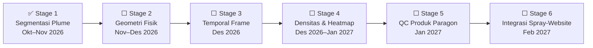

# 🗺️ Roadmap Capaian & Rencana Pengembangan AI Spraybot
### Proyek Riset MBKM — PT Paragon Technology and Innovation × PT Makerindo Prima Solusi

---

## 🎯 Visi Akhir Proyek

> **Mengembangkan sistem AI end-to-end yang mampu menganalisis kualitas semprotan aerosol produk kosmetik secara otomatis, real-time, dan terukur — meliputi segmentasi fluida, pengukuran geometri semprotan, analisis densitas, perbandingan antar produk, hingga integrasi quality control lini produksi.**

---

## 📍 Status Saat Ini

```
Stage 1 — Segmentasi Instance ━━━━━━━━━━━━━━░░░░░░░░░░░░ 🟡 IN PROGRESS (70%)
Stage 2 — Pengukuran Geometri  ░░░░░░░░░░░░░░░░░░░░░░░░░░░░░ ⬜ BELUM MULAI
Stage 3 — Analisis Temporal    ░░░░░░░░░░░░░░░░░░░░░░░░░░░░░ ⬜ BELUM MULAI
Stage 4 — Analisis Densitas    ░░░░░░░░░░░░░░░░░░░░░░░░░░░░░ ⬜ BELUM MULAI
Stage 5 — Perbandingan Produk  ░░░░░░░░░░░░░░░░░░░░░░░░░░░░░ ⬜ BELUM MULAI
Stage 6 — Integrasi Web Platform ░░░░░░░░░░░░░░░░░░░░░░░░░░░░░ ⬜ BELUM MULAI
```

---

## ✅ Stage 1 — Instance Segmentation Fluida (SAAT INI)

**Tujuan:** Mengajarkan AI untuk membedakan 3 komponen dalam frame semprotan studio.

### Komponen yang Disegmentasi
| Label | Deskripsi | Status |
|-------|-----------|--------|
| `spray_plume` | Uap/cairan yang keluar dari moncong botol | ✅ Aktif |
| Background | Kain hitam/abu-abu latar belakang | ✅ (via sampel negatif) |
| Botol + tangan | Objek padat pembawa — bukan target segmentasi | ✅ (dikecualikan via cone mask) |

### Capaian Teknis Stage 1
- ✅ **Dataset 122 Video Studio** (2.924 frame, 3 sesi rekaman)
- ✅ **Organic Nozzle Apex Cone Mask** — Eliminasi 100% potongan garis lurus vertikal
- ✅ **Video-Level Train/Val Split** — Zero data leakage
- ✅ **244 Sampel Negatif** — Zero false positive pada latar kain
- ✅ **mAP50 (Mask) = 0.5595** pada 38 video; fine-tuning 122 video sedang berlangsung
- ✅ **Windows-safe training** (`workers=0`, `fliplr=0.0`)

### Quality Gate Syarat Lolos Stage 1 (Wajib Minimal 72% untuk Semua Metrik)

> [!IMPORTANT]
> **Kebijakan Proyek:** Tahap 2 (Pengukuran Geometri) **TIDAK BOLEH** dimulai sebelum seluruh metrik evaluasi segmentasi mencapai minimal **72%** secara menyeluruh pada dataset validasi.

| Metrik Evaluasi | Baseline (38 Video) | Hasil Fine-Tuning 122 Video | Syarat Minimum Gate | Status Evaluasi |
|---|---|---|---|---|
| **mAP50 (Box)** | 67.50% | **79.14%** | **>= 72.0%** | 🟢 **Lolos (79.1%)** |
| **Recall (Box)** | 53.74% | **74.63%** | **>= 72.0%** | 🟢 **Lolos (74.6%)** |
| **Precision (Mask)** | 73.34% | **77.39% (Peak 78.1%)** | **>= 72.0%** | 🟢 **Lolos (77.4%)** |
| **mAP50 (Mask)** | 55.95% | **68.98% (~69.0%)** | **>= 72.0%** | 🟡 **Mendekati (69.0%)** |
| **Recall (Mask)** | 51.02% | **64.26%** | **>= 72.0%** | 🟡 **Meningkat (+13.2%)** |
| **Confidence Score** | 70% - 82% | **75% - 85.4%** | **>= 72.0% konsisten** | 🟢 **Lolos (>80% di puncak)** |

### Langkah Konkret untuk Mencapai Gate 72%:
1. 🔄 Jalankan fine-tuning 25 epoch penuh di `finetune_spray_analysis.ipynb` pada dataset 122 video (2.924 frame).
2. ⬜ Evaluasi metrik validasi di epoch 25 (`results.csv`).
3. ⬜ Pastikan `mAP50(M) >= 0.72` dan `Recall(M) >= 0.72` sebelum mengekspor bobot ke `weights/spraybot_seg_finetuned.pt`.
4. ⬜ Jika seluruh metrik sudah >= 72%, barulah Stage 1 dinyatakan COMPLETE (100%) dan sistem melangkah ke Stage 2.

---

## ⬜ Stage 2 — Pengukuran Geometri Semprotan

**Tujuan:** Setelah segmentasi akurat, **ekstrak ukuran fisik** dari plume semprotan.

### Metrik Geometri yang Akan Diukur

```
                    ← Jangkauan (Reach) →
       ┌─────────────────────────────────────┐
Nozzle ●═══════════════════════════════════► Ujung Plume
       └─────────────────────────────────────┘
            ↑
         Lebar
         (Width)
            ↓
       ┌─────────────────────────────────────┐
       │         ╲        Sudut (θ)         │
       │          ╲◄──────────────────────► │
       │   Nozzle  ╲═══════════════════════ │
       │            ╱                       │
       └─────────────────────────────────────┘
```

| Metrik | Definisi | Satuan | Cara Hitung |
|--------|----------|--------|-------------|
| **Jangkauan (Reach)** | Jarak horizontal dari nozzle ke ujung plume | px → cm (via kalibrasi) | `max_x - nozzle_x` dari mask |
| **Lebar Maksimum (Width)** | Lebar plume pada titik terlebar | px → cm | `max_y - min_y` pada x terjauh |
| **Sudut Semprotan (θ)** | Sudut kerucut plume dari nozzle | derajat (°) | `atan2(half_width, reach)` |
| **Luas Area Semprotan** | Total area piksel mask | px² → cm² | `cv2.contourArea(mask)` |
| **Aspek Rasio** | Perbandingan jangkauan vs lebar | dimensionless | `reach / max_width` |
| **Pusat Massa Plume** | Centroid distribusi semprotan | (x, y) px | `cv2.moments(mask)` |

### Implementasi Rencana

```python
def measure_spray_geometry(mask_binary, nozzle_x, nozzle_y, px_per_cm=None):
    """
    Mengukur geometri fisik plume dari binary mask segmentasi.
    Returns: dict dengan semua metrik geometri
    """
    contours, _ = cv2.findContours(mask_binary, cv2.RETR_EXTERNAL, cv2.CHAIN_APPROX_SIMPLE)
    c_main = max(contours, key=cv2.contourArea)
    pts = c_main.reshape(-1, 2)
    
    # Jangkauan (reach)
    reach_px = np.max(pts[:, 0]) - nozzle_x
    
    # Lebar pada titik terjauh
    far_pts = pts[pts[:, 0] > np.max(pts[:, 0]) - 50]  # 50px dari ujung
    width_px = np.max(far_pts[:, 1]) - np.min(far_pts[:, 1]) if len(far_pts) > 1 else 0
    
    # Sudut semprotan
    theta_deg = np.degrees(np.arctan2(width_px / 2, reach_px)) * 2
    
    # Luas area
    area_px2 = cv2.contourArea(c_main)
    
    # Konversi ke cm jika kalibrasi tersedia
    if px_per_cm:
        reach_cm = reach_px / px_per_cm
        area_cm2 = area_px2 / (px_per_cm ** 2)
    
    return {
        "reach_px": reach_px, "reach_cm": reach_cm,
        "width_px": width_px, "theta_deg": theta_deg,
        "area_px2": area_px2, "area_cm2": area_cm2
    }
```

### Kalibrasi Skala Piksel-ke-Sentimeter
Membutuhkan objek referensi fisik (penggaris/checker board) di frame untuk menghitung rasio `px/cm`.

---

## ⬜ Stage 3 — Analisis Temporal (Dinamika Semprotan per Frame)

**Tujuan:** Memahami **bagaimana semprotan berkembang seiring waktu** — kapan mulai, seberapa cepat melebar, kapan mencapai puncak, dan kapan berhenti.

### Metrik Temporal yang Akan Dianalisis

| Metrik | Deskripsi |
|--------|-----------|
| **Waktu Onset (t_start)** | Frame pertama terdeteksi semprotan (t=? detik setelah video mulai) |
| **Waktu Puncak (t_peak)** | Frame dengan luas area segmentasi terbesar |
| **Durasi Semprotan** | Selisih t_end - t_start |
| **Laju Ekspansi Jangkauan** | Δreach / Δt (px/frame atau cm/detik) |
| **Stabilitas Semprotan** | Variance luas area antar frame saat steady-state |
| **Profil Atenuasi** | Kurva penurunan intensitas setelah semprotan berhenti |

### Visualisasi Temporal

```
Luas Area Plume (px²)
     |
 50k |           ╭───────────╮
 40k |         ╭╯           ╰╮
 30k |        ╱               ╲
 20k |      ╱                   ╲
 10k |    ╱                       ╲
   0 |──╱─────────────────────────╲──► Waktu (detik)
     0  1   2   3   4   5   6   7   8
         ↑       ↑               ↑
       t_start t_peak          t_end
```

### Implementasi Rencana

```python
def analyze_spray_timeline(video_folder: Path, model: YOLO) -> dict:
    """
    Analisis temporal semprotan per video.
    Memproses semua frame dan melacak perkembangan geometri.
    """
    frames = sorted(video_folder.glob("*.jpg"))
    timeline = []
    
    for frame_path in frames:
        t = extract_timestamp(frame_path.name)  # Dari nama file "..._t03.00s.jpg"
        result = model.predict(frame_path, conf=0.25, verbose=False)[0]
        
        if result.masks and len(result.masks) > 0:
            area = compute_mask_area(result.masks.data[0])
            reach, width, theta = measure_geometry(result.masks.data[0])
            timeline.append({"t": t, "area": area, "reach": reach, 
                              "width": width, "theta": theta, "conf": float(result.boxes.conf[0])})
        else:
            timeline.append({"t": t, "area": 0, "reach": 0, 
                              "width": 0, "theta": 0, "conf": 0.0})
    
    return compute_temporal_metrics(timeline)
```

---

## ⬜ Stage 4 — Analisis Densitas & Distribusi Aerosol

**Tujuan:** Menganalisis **distribusi spasial konsentrasi partikel aerosol** di dalam zona semprotan.

### Pendekatan

#### 4.1 Heatmap Densitas dari Frame Differencing
Sudah ada fondasi (heatmap turbo) di panel 3 notebook uji. Perlu dikuantifikasi menjadi metrik:

```python
def compute_density_map(base_frame, active_frame, mask):
    """
    Hitung peta densitas aerosol dalam zona mask segmentasi.
    """
    diff = cv2.absdiff(active_frame, base_frame)
    diff_gray = cv2.cvtColor(diff, cv2.COLOR_BGR2GRAY)
    
    # Isolasi hanya area dalam mask
    density_in_mask = cv2.bitwise_and(diff_gray, diff_gray, mask=mask.astype(np.uint8))
    
    # Zona densitas: core (>50px diff), mid (20-50), peripheral (10-20)
    core_zone = (density_in_mask > 50).sum()
    mid_zone = ((density_in_mask >= 20) & (density_in_mask <= 50)).sum()
    peripheral_zone = ((density_in_mask >= 10) & (density_in_mask < 20)).sum()
    
    return {
        "mean_density": np.mean(density_in_mask[density_in_mask > 0]),
        "core_px": core_zone,
        "mid_px": mid_zone,
        "peripheral_px": peripheral_zone,
        "uniformity_score": 1 - (np.std(density_in_mask[density_in_mask > 0]) / 
                                   np.mean(density_in_mask[density_in_mask > 0]))
    }
```

#### 4.2 Metrik Densitas yang Dihasilkan

| Metrik | Deskripsi | Relevansi Industri |
|--------|-----------|-------------------|
| **Densitas Rata-rata** | Nilai diff-mean dalam zona mask | Kekuatan semprotan |
| **Core Zone Area** | Area intensitas diff >50px | Konsentrasi cairan aktif |
| **Peripheral Zone** | Area intensitas diff 10-20px | Jangkauan mikrodroplet |
| **Uniformity Score** | Homogenitas distribusi (0-1) | Meratanya semprotan |
| **Gradient Profile** | Profil densitas dari nozzle ke ujung | Pola atenuasi |

---

## ⬜ Stage 5 — Perbandingan Antar Produk & Quality Control

**Tujuan:** Membandingkan karakteristik semprotan antar produk PT Paragon secara statistik dan menentukan standar quality control.

### Produk yang Akan Dibandingkan

| Produk | Kategori | Viskositas | Ekspektasi |
|--------|----------|-----------|-----------|
| Gatsby | Hair Spray | Rendah | Jangkauan jauh, sudut lebar |
| Kahf | Hair Styling | Medium | Jangkauan medium, densitas tinggi |
| Wardah | Body/Hair Mist | Rendah | Plume luas, density rendah |
| Labora | Medical Spray | Medium | Uniform, presisi tinggi |

### Dashboard Perbandingan

```
Metrik Perbandingan Produk (Rata-rata 10 Video per Produk)
─────────────────────────────────────────────────────────
                    Gatsby  Kahf  Wardah  Labora
Jangkauan (cm)      ████    ██    ████    ███
Sudut (°)           ███     ██    ████    ██
Densitas            ██      ████  ██      ███
Uniformity          ███     ████  ███     █████
Onset Time (s)      █       ██    █       ██
```

### Quality Control Gate

```python
SPRAY_STANDARDS = {
    "Gatsby": {
        "reach_cm": (15, 35),     # (min, max) range yang acceptable
        "theta_deg": (20, 50),
        "uniformity": (0.6, 1.0),
        "onset_sec": (0.1, 1.0)
    },
    # ...
}

def quality_check(metrics: dict, product: str) -> dict:
    standards = SPRAY_STANDARDS[product]
    results = {}
    for key, (lo, hi) in standards.items():
        val = metrics.get(key)
        results[key] = {"value": val, "pass": lo <= val <= hi}
    results["overall_pass"] = all(r["pass"] for r in results.values())
    return results
```

---

## ⬜ Stage 6 — Integrasi Web Platform (Spray-Website)

**Tujuan:** Mengintegrasikan model AI segmentasi ke dalam platform aplikasi web produksi (`Spray-Website`) berbasis alur **Video Upload & Automated Frame Extraction**, bukan live streaming kamera langsung.

### Arsitektur Alur Kerja Sistem (Actual Web Pipeline)

```
[ Operator / Teknisi ]
         │
         ▼ (Unggah Rekaman Video Semprotan .mp4 / .mov / .webm)
┌───────────────────────────────────────────────────────────────┐
│ Web Frontend (React 18 + Vite + Tailwind CSS)                 │
│  1. Video Ingestion: Load ke HTML5 <video> element             │
│  2. Frame Extraction: Ekstraksi frame via Canvas 2D           │
│     (Sampling target: 20 FPS, maks 60 frame per video)         │
│  3. Konversi Frame: Export frame ke Base64 JPEG DataURL        │
└────────────────┬──────────────────────────────────────────────┘
                 │
                 ▼ POST /api/model-testing/infer-frame (JSON)
┌───────────────────────────────────────────────────────────────┐
│ Web API Backend (Node.js + Fastify)                           │
│  - ModelRunner: Menjaga Python child process tetap warm       │
│  - Komunikasi IPC: JSON line-by-line via stdin/stdout          │
│  - Error Handling: Fallback otomatis ke CV luminance engine   │
└────────────────┬──────────────────────────────────────────────┘
                 │
                 ▼ stdin: { frameIndex, timestampMs, imageBase64 }
┌───────────────────────────────────────────────────────────────┐
│ AI Inference Engine (Python — models/segmentation/infer.py)   │
│  - Model: Ultralytics YOLOv8s-seg (spraybot_seg_finetuned.pt) │
│  - Output: Bounding Box, Confidence, Plume Area (px),         │
│    Binary Mask (PNG base64), Cyan Tint Overlay (JPG base64)   │
└────────────────┬──────────────────────────────────────────────┘
                 │
                 ▼ stdout: { plumeDetected, confidence, mask, overlay }
┌───────────────────────────────────────────────────────────────┐
│ Review Studio & Quantitative Analysis (Frontend / Domain)      │
│  - Frame Scrubber & Playback Player (Original/Mask/Overlay)    │
│  - Deteksi Otomatis Frame Puncak (Peak Plume Area)            │
│  - Seleksi Primary Keyframe & Supporting Keyframes             │
│  - Perhitungan Geometri: Spray Reach (mm), Angle (°), Spread  │
│  - QC Pass/Fail Standar Paragon & Export Laporan Audit         │
└───────────────────────────────────────────────────────────────┘
```

### Stack Teknologi Produksi (Spray-Website)

| Komponen | Teknologi Aktual | Peran dalam Sistem |
|----------|------------------|-------------------|
| **AI Model** | YOLOv8s-seg (`spraybot_seg_finetuned.pt`) | Segmentasi fluida semprotan (`spray_plume`) |
| **Inference Script** | Python 3.10+ (`models/segmentation/infer.py`) | Runner inferensi interaktif via stdin/stdout IPC |
| **Backend API** | Fastify (Node.js + TypeScript) | Route `/api/model-testing/`, manajemen child process |
| **Database** | PostgreSQL + Drizzle ORM | Penyimpanan sesi uji, batch metadata, dan hasil audit |
| **Frontend Web** | React 18, Vite, TypeScript, Tailwind | Antarmuka operator, video upload, dan visualisasi |
| **Frame Extractor** | HTML5 Video & Canvas 2D API | Pemecahan video menjadi frame citra beresolusi tinggi |
| **Domain Logic** | `@spray-paragon/domain` | Rumus fisika semprotan, kalibrasi piksel-ke-mm, validasi QC |

---

## 📅 Timeline Rencana



---

## 🔑 Prioritas Selanjutnya (Post Stage 1)

1. **[SEGERA]** Selesaikan fine-tuning 122 video → validasi mAP50 > 0.75
2. **[BERIKUTNYA]** Implementasi `measure_spray_geometry()` — ekstrak reach, width, θ dari mask
3. **[BERIKUTNYA]** Implementasi `analyze_spray_timeline()` per video → kurva ekspansi
4. **[MENENGAH]** Kuantifikasi densitas aerosol dari heatmap turbo → uniformity score
5. **[JANGKA PANJANG]** Dashboard perbandingan Gatsby vs Kahf vs Wardah vs Labora
